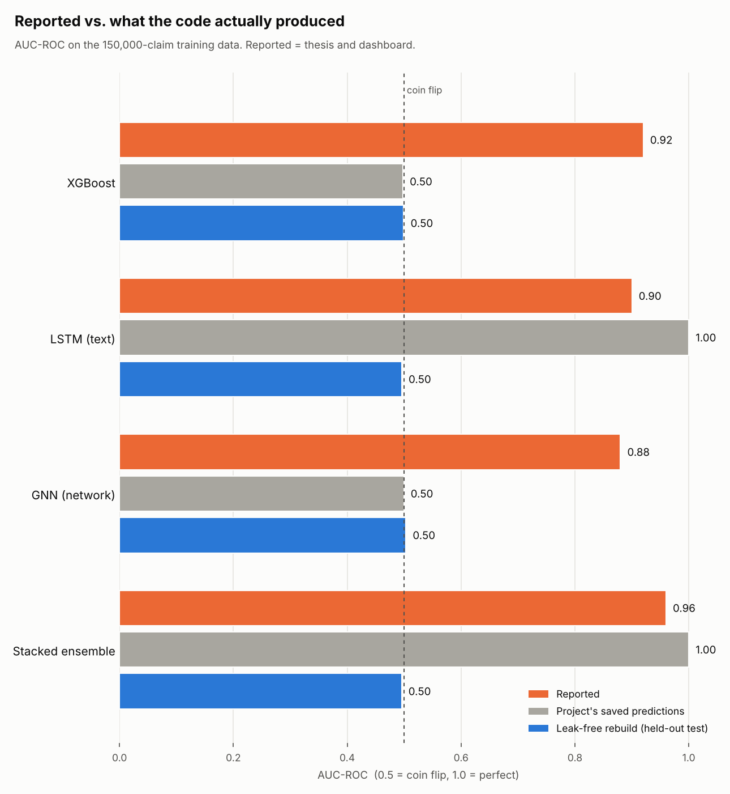
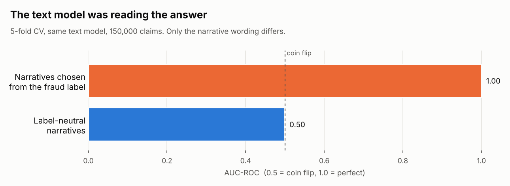
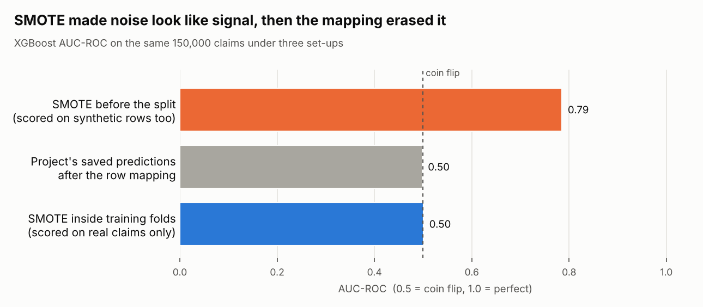
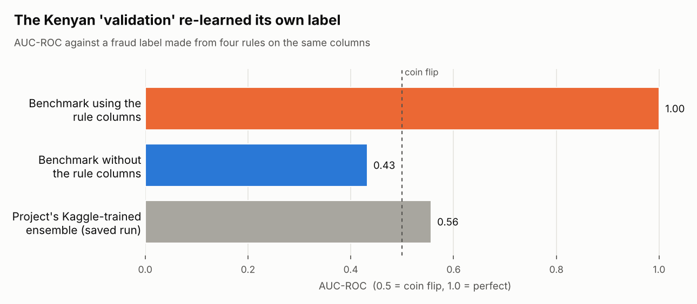

# Motor insurance fraud detection: auditing my final-year ensemble

For our final-year project in BSc Actuarial Science at JKUAT (Group 4), we built a stacked ensemble of XGBoost, an LSTM and a graph neural network to detect motor insurance fraud, and reported an F1 score of 85.3%.

After submission I audited the code and the files it saved, and the result did not hold up. **The training data contains no fraud signal at all, and every high score the project produced came from one of three bugs.** This repository documents how I found each bug, proves it with code you can run, and rebuilds the same ensemble correctly.

📄 [Original thesis (PDF)](Motor-Insurance-Fraud-Ensemble-Thesis.pdf) · 🔍 [Audit scripts](#reproduce-the-audit) · 🧾 [Original R code](#repository-contents)

---

## Summary



| | XGBoost | LSTM (text) | GNN (network) | Stacked ensemble |
|---|---|---|---|---|
| **Reported** in the thesis and dashboard | 0.92 | 0.90 | 0.88 | 0.96 |
| **Project's saved predictions**, recomputed | 0.50 | 1.00 | 0.50 | 1.00 |
| **Leak-free rebuild**, held-out test set | 0.50 | 0.50 | 0.50 | 0.50 |

AUC-ROC: 0.5 is a coin flip and 1.0 is perfect. On the saved predictions:

- **XGBoost and the GNN** are coin flips.
- **The LSTM and the ensemble** are perfect. A perfect score on real-world fraud data is a sign of a bug, not of a good model.

The reported figures, including F1 85.34%, the 82.57% Kenyan F1, the fraud-type detection rates and the SHAP features such as `claim_velocity_12m`, don't appear in any output file the project saved. I could only find them typed into the thesis, the slides and a results dashboard.

## Finding 0: the training data has no signal

The project trained on a 150,000-claim file with a 30% fraud rate. The thesis describes it as 15,207 claims at 14.8%. Before looking for bugs, I checked whether there was anything to find (`audit_01_signal_check.py`):

- **`ClaimAmount` is 20,000 on every row**, so the most important variable in motor fraud carries no information.
- **No column is related to the fraud label.** The strongest association across all 32 columns is Cramér's V = 0.021, where 0.1 would still be "weak". Only 2 of 32 columns pass p < 0.05, about what chance alone produces.
- **Correctly cross-validated models score at chance.** XGBoost gets AUC 0.501 and logistic regression 0.502.

So any score well above 0.5 on this data must come from the pipeline, not the claims.

## Finding 1: the text model was reading the answer

The data has no free text, so `original_LSTM3.Rmd` generates a "claim narrative" for each claim. It **chooses the sentence template from the fraud label**:

```r
if(row["FraudFound"]=="Yes"){
  sample(templates_fraud,1)[[1]]   # "...the circumstances seemed unusual." / "...witness accounts were inconsistent."
}else{
  sample(templates_legit,1)[[1]]   # "...This appears to be a straightforward claim." / "...All documentation is consistent."
}
```

Any text model only has to learn four phrases. `audit_02_text_leak.py` rebuilds both versions and scores the same text model on each:



The LSTM predictions the project saved and fed to the ensemble are 0 or 1 to six decimal places and match the label on 100.00% of claims, so they came from the leaky narratives. A later script, `original_LSTM_Updated.Rmd`, switched to neutral templates, but the predictions the ensemble loaded are still the leaky ones.

**Fix:** build features only from information available before the label is known. Then treat any perfect score as a bug to find, not a result.

## Finding 2: SMOTE inflated XGBoost, then a row mapping scrambled it

`original_xgboost2.Rmd` runs SMOTE on the **whole dataset before splitting**. Its test set and cross-validation folds therefore contain synthetic claims. On noise, the model learns to tell SMOTE's interpolated rows from real ones. In my reproduction, synthetic fraud versus real fraud is separable with AUC 1.00, which makes the overall score look like 0.79.

Step 16 then maps the out-of-fold predictions back to the original 150,000 claims. It assumes SMOTE keeps the original rows first and in order. In fact, `smotefamily::SMOTE` returns **all fraud rows first, then all non-fraud rows**. Claim *i* receives the prediction for an unrelated row, and the labels of the two rows agree only 46.0% of the time.



| | AUC-ROC |
|---|---|
| Saved XGBoost predictions, scored on the SMOTE rows | 0.751 |
| Same predictions after the Step 16 mapping (what the ensemble received) | 0.498 |
| Reproduction: SMOTE before the split | 0.785 |
| Reproduction: SMOTE inside each training fold, scored on real claims | 0.501 |

**Fix:** split first, resample only inside training folds, and keep predictions keyed by claim ID rather than by row position.

## Finding 3: the Kenyan validation graded models against their own inputs

The simulated Kenyan dataset has no fraud label, so `original_Kenyan_updated.Rmd` creates one: a claim counts as fraud if any of four rules fires on `ClaimAmount`, `Previous_Claims_Count`, `Vehicle_Age` and `Accident_Cause`. The "Kenyan XGBoost benchmark" is trained on those same columns, so it just re-learns the rules. A depth-4 decision tree reproduces the label on 100% of rows. One rule uses a column that doesn't exist, so it never fires.



The project's own final Kenyan run, applying the Kaggle-trained ensemble, flagged every claim as fraud: recall 1.00, precision 0.05, **F1 0.095**. The 82.57% Kenyan F1 in the thesis doesn't match it. The file itself has 2,000 claims across 8 regions, not the 3,200 claims across 4 counties described. An earlier script, `original_Kenya_1.Rmd`, replaced the model outputs with values computed from the answer (`ifelse(FraudProxy == 1, 0.7, 0.3)`), which produced a 100% score.

**Fix:** a validation label must come from outside the model's inputs, such as confirmed investigation outcomes. Without one, report the work as exploratory.

## The rebuild: the same ensemble, done correctly

`audit_05_clean_pipeline.py` keeps the original design of three learners stacked with a logistic-regression meta-learner, and fixes the process:

1. **Split first.** A 20% test set is held out and touched once, at the end.
2. **No SMOTE.** Class weights handle imbalance, so every score is on real claims.
3. **Predictions stay aligned.** Out-of-fold predictions keep their row index.
4. **Label-neutral text.** The text learner reads neutral narratives. It uses TF-IDF and logistic regression as a fast stand-in for the LSTM.
5. **Leak-free network features.** For each claim, the network learner uses how often claims sharing its agent, policy or garage were fraud. These rates are cross-fitted, so a claim never sees its own label. It stands in for the GNN.
6. **Meta-learner fitted on training data only.** The meta-learner and its decision threshold are fitted on training out-of-fold predictions.

**A model that scores 0.5 might just be broken**, so the script also runs a **positive control**. I planted a known fraud pattern in the same claims: policy-holder fault, past claims, external agents, and three "collusive" agents. Then I ran the identical pipeline.

| Held-out test set (30,000 claims) | Real `FraudFound` label | Planted fraud pattern |
|---|---|---|
| XGBoost (tabular) | 0.499 | 0.696 |
| Text model (LSTM stand-in) | 0.496 | 0.623 |
| Network model (GNN stand-in) | 0.503 | 0.562 |
| **Stacked ensemble** | **0.496** | **0.696** |
| Best possible (scoring with the true formula) | — | 0.697 |

On the planted pattern, the ensemble reaches the best score that pattern allows (0.696 against 0.697), so the pipeline works. On the real label it stays at 0.50, because there is nothing in this data to learn.

## What I'd do differently

- **Check that the data has signal first.** Profile every column and run a simple cross-validated baseline before building anything complex.
- **Split before any resampling, imputation or feature engineering.**
- **Join predictions by ID, never by row position.**
- **Treat a score near 1.0 as a bug report.**
- **Run a positive control** to prove the pipeline can find a signal you planted.
- **Report numbers only from saved outputs**, regenerated by a script, so every figure can be traced to code.

## Reproduce the audit

```bash
pip install -r requirements.txt
python audit_01_signal_check.py      # ~30 s   needs data_set_2_kaggle.csv
python audit_02_text_leak.py         # ~1.5 min
python audit_03_smote_alignment.py   # ~1 min
python audit_04_kenya_circular.py    # seconds  needs Kenyan_Motor_Insurance_2023_2024.csv
python audit_05_clean_pipeline.py    # ~2.5 min
python audit_06_summary_chart.py     # seconds  uses only the saved_*.rds files and audit_05 output
```

Each script prints its numbers and writes an `audit_0X_results.csv`. Seeds are fixed, so results match the tables above.

### Data

The two CSV files aren't included in this repository, because I couldn't confirm their source or licence:

- **`data_set_2_kaggle.csv`** (150,000 rows) uses the column layout of the public Kaggle vehicle-claim fraud dataset (`fraud_oracle`, 15,420 claims). Its values appear randomised.
- **`Kenyan_Motor_Insurance_2023_2024.csv`** (2,000 rows) is a simulated dataset.

If you have them, place them next to the scripts. The `saved_*.rds` files are the project's own saved predictions and are included, so `audit_06_summary_chart.py` runs without either CSV.

## Repository contents

| File | What it is |
|---|---|
| `README.md` | This audit |
| `audit_common.py`, `audit_01` to `audit_06` `*.py` | Audit and rebuild scripts (Python) |
| `audit_fig1_summary.png` to `audit_fig4_kenya.png` | Audit charts |
| `requirements.txt` | Python packages |
| `saved_*.rds`, `saved_kenya_final_model_comparison.csv` | Predictions and results saved by the original R pipeline |
| `original_*.Rmd` | Original R notebooks: XGBoost, LSTM (both versions), GNN, meta-learner, Kenyan validation (both versions) |
| `Motor-Insurance-Fraud-Ensemble-Thesis.pdf`, `main.tex`, `sources.bib`, `fig1.png` to `fig15.png` | The thesis as submitted |

The thesis is kept as submitted. Its literature review, design and Kenyan-context chapters still stand. Read its results chapter alongside the findings above.

## Team

Group 4, Department of Statistics and Actuarial Sciences, JKUAT: Mwangi Gidraff Mbugua, Obwana John Opwapo, Wanjiru Wangui Caroline, John Munyaka Ndinda and Mwaura Eric Muiruri. Supervisors: Dr Herbert Imboga and Henry Kissinger.

The audit and the Python rebuild are my own work, done after submission with the group's agreement.
